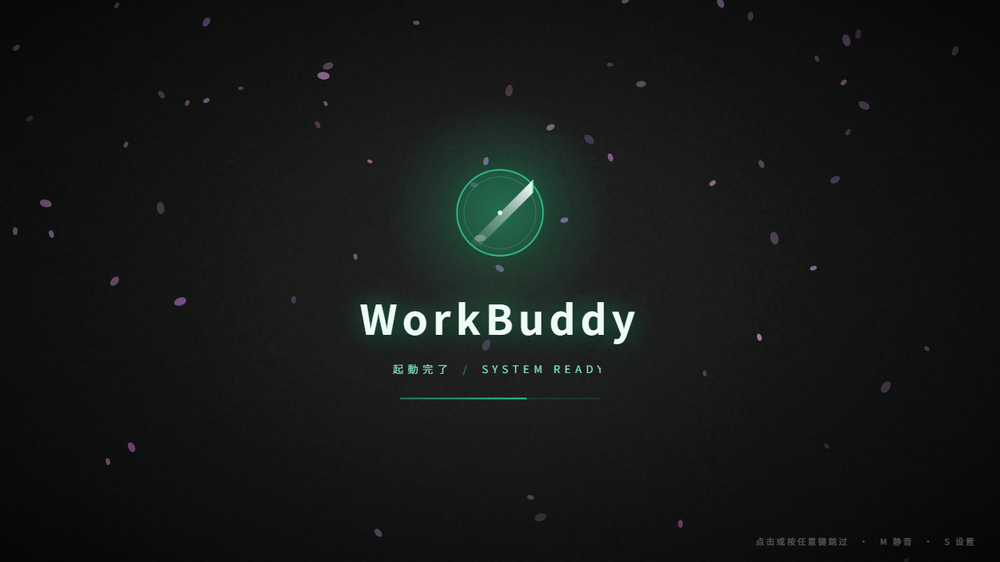
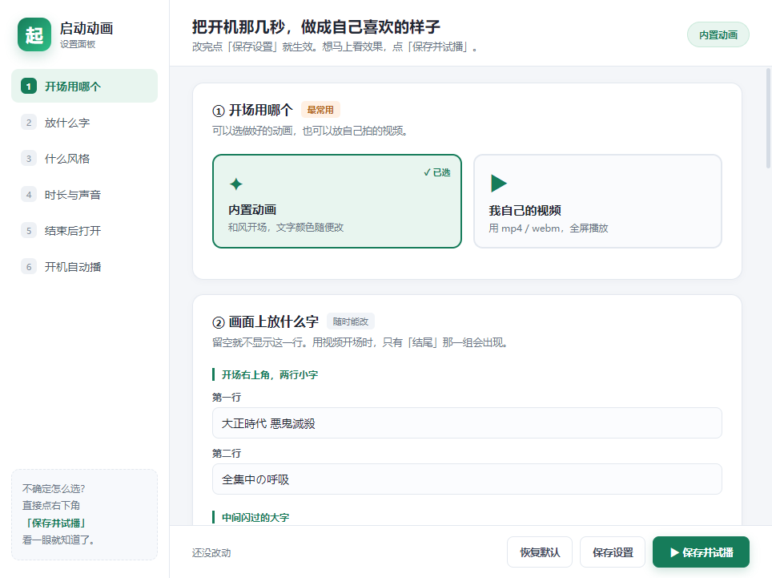
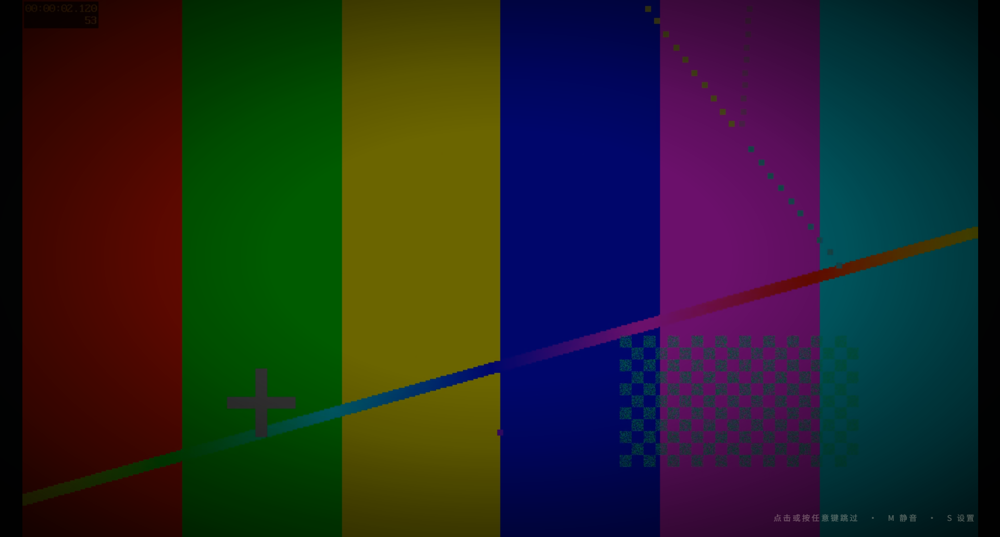

# Kimetsu Boot · 可自定义的 Windows 启动动画

给「打开软件」这几秒加一段开场：内置一套和风动画（文字、配色、时长、音效全都能改），也能**换成你自己的视频**；播完自动打开任意程序并把窗口拉到最前。

全程纯本地运行，不联网、不上传、不需要账号。配置写在一个 JSON 文件里，也有可视化设置面板，不用碰代码。



---

## 一、先选对版本（很重要）

| 版本 | 文件 | 启动速度 | 适合 |
|---|---|---|---|
| **绿色目录版（推荐）** | `dist/win-unpacked/` 整个文件夹 | **快**，双击 `KimetsuBoot.exe` 直接运行 | 日常使用 |
| 单文件版 | `KimetsuBoot-Portable.exe` | 偏慢 | 发给别人、网盘备份、GitHub Release |

> 为什么单文件版慢：它是一个自解压包，每次启动都要先把约 80 MB 内容解压到临时目录，再启动 Electron。
> 绿色目录版没有这一步。**日常请用目录版**，把整个 `win-unpacked` 文件夹放到固定位置即可。
>
> 本机实测（从双击到窗口出现，各跑 3 次）：
>
> | 版本 | 三次耗时 | 平均 |
> |---|---|---|
> | 绿色目录版 | 949 / 906 / 875 ms | **0.9 秒** |
> | 单文件版 | 9052 / 8988 / 8643 ms | **8.9 秒** |
>
> 差不多差了 10 倍。嫌慢的话，换目录版就对了。

### 目录里这几个怎么用

| 想做的事 | 操作 |
|---|---|
| 正常播放动画 → 打开软件 | 双击 `KimetsuBoot.exe` |
| 打开设置面板 | 双击 `动画设置.bat`，或命令行加 `--settings` |
| 开机自动播放 | 设置面板第 ⑥ 项打开开关 |
| 跳过动画直接打开软件 | 命令行 `KimetsuBoot.exe --skip` |

动画播放中：**点一下 / 按任意键** 跳过，`M` 静音，`S` 打开设置。

---

## 二、设置面板能改什么



1. **开场用哪个** — 内置动画 or 自己的视频
2. **放什么字** — 开场小字、刀光大字、水/炎、中央标题、红印章、结尾品牌名与图标
3. **什么风格** — 四套模板一键套用（鬼灭和风 / 水墨素白 / 赛博霓虹 / 晨曦金），进阶里还能逐项调 12 个颜色
4. **播多久、要不要声音** — 5～24 秒、内置音效开关与音量、落花密度
5. **结束后打开哪个软件** — 默认自动找 WorkBuddy，可换成任意 exe；已开着就切到前台，不重复开
6. **开机自动播放** — 一键开关，随时可关

底部三个按钮：**保存设置** / **保存并试播** / **恢复默认**。不确定效果就点「保存并试播」，播完会自动回到设置窗口。

---

## 三、用自己的视频当开场

在设置面板第 ① 项选「我自己的视频」→ 点「选一个视频…」。

| 选项 | 怎么选 |
|---|---|
| 视频格式 | **mp4（H.264）最稳**，webm 也可以；mkv/avi 浏览器不一定能播 |
| 画面怎么摆 | 屏幕形状和视频不一样时：**铺满屏幕**会裁掉边角；**完整显示**会留黑边但画面完整 |
| 播多久 | 整段播完，或只播前 N 秒 |
| 声音 | 默认静音；想用视频原声就取消勾选并调音量 |
| 播完之后 | 默认接上结尾图标 + 文字，停留一会儿再打开软件；也可以关掉直接进软件 |

几点说明：

- 配置里存的是**视频文件的绝对路径**，别删、别改名、别移动。
- 视频找不到 / 格式不支持 / 解码失败时，会**自动回退到内置动画**，不会卡在黑屏。
- 大文件也能播：主进程用自定义协议按 Range 分段喂给播放器，不会一次性读进内存。
- 视频开场时，第 ② 步的文案只有「结尾」那一组会显示。



---

## 四、内置动画长什么样

约 10 秒（可在 5～24 秒之间调）：

| 时间 | 画面 |
|---|---|
| 0–2s | 和纸纹理、落花、竖排和风小字 |
| 2–3s | 市松方格纹 + 青海波涌起 |
| 3.3s | 抜刀：斜向刀光、白闪、火花、刀鸣太鼓 |
| 4–6s | 左侧「水」青蓝水带 / 右侧「炎」橙色火焰 |
| 6.3s | 中央大字题字 + 朱红印章 |
| 8–10s | 收束到徽标、品牌名、进度条 → 淡出 → 打开软件 |


音效是 Web Audio 实时合成的（太鼓、刀鸣、风声、编钟），没有引用任何外部音频，断网也能用，也不涉及素材版权。

---

## 五、配置文件

位置：**和 exe 放在同一个目录**，文件名 `kimetsu-boot.config.json`。第一次运行自动生成；设置面板里点「打开所在文件夹」就能找到。

```jsonc
{
  "preset": "kimetsu",          // 当前模板，仅作记录
  "duration": 10,               // 内置动画总时长（秒）
  "sound": true,                // 内置音效
  "volume": 0.7,
  "petals": true,
  "petalDensity": 74,
  "text": {                     // 所有画面文字
    "prologue1": "大正時代 悪鬼滅殺",
    "title": "全集中 · 常中",
    "brand": "WorkBuddy",
    "brandSub": "起動完了 / SYSTEM READY"
    // ...其余字段见 shared/defaults.js
  },
  "theme": {                    // 12 组 [r,g,b] 颜色
    "bg": [8, 11, 13],
    "water": [64, 186, 240],
    "fire": [240, 96, 22],
    "accent": [46, 213, 150]
  },
  "video": {
    "enabled": false,
    "file": "D:/Videos/intro.mp4",
    "fit": "cover",             // cover | contain
    "mute": true,
    "volume": 0.8,
    "maxSeconds": 0,            // 0 = 整段播完
    "showFinale": true,
    "finaleSeconds": 1.8
  },
  "launch": {
    "path": "",                 // 留空 = 自动找 WorkBuddy
    "args": "",
    "windowTitle": "WorkBuddy",
    "processName": "",
    "activate": true,
    "autoDetect": true
  },
  "autostart": false
}
```

可以直接手改，也可以用 `--config <路径>` 指定另一份配置。`examples/` 里有三份现成示例。

**所有配置都会经过校验**：字段写错、数值越界、类型不对，都会自动回退到安全默认值，不会让动画崩掉。

---

## 六、命令行参数

| 参数 / 环境变量 | 作用 |
|---|---|
| `--settings` | 打开设置面板（不播动画） |
| `--skip` / `--now` | 完全跳过动画，只执行「打开软件」 |
| `--config <路径>` | 指定另一份配置文件 |
| `KIMETSU_TARGET` | 用环境变量指定结束后要打开的程序路径 |
| `WB_SELFTEST=1` | 开发用：按动画时钟抓 6 张关键帧到 `selftest/` |
| `WB_VIDEO_SELFTEST=1` | 开发用：视频模式抓帧 |
| `WB_NO_LAUNCH=1` | 开发用：不启动目标程序 |

---

## 七、从源码运行 / 打包

需要 Node.js 18+ 与 Windows。

```bash
npm ci                  # 安装 Electron 与 electron-builder
npm start               # 直接跑动画（开发模式）
npm run settings        # 打开设置面板
npm run selftest        # 抓帧自检，结果在 selftest/
npm run dist            # 同时产出绿色目录版 + 单文件版，输出到 dist/
python scripts/make-icon.py   # 可选：重新生成 exe 图标（需要 Pillow）
```

打包走 `electron-builder`，`build` 字段在 `package.json` 里。GitHub Actions 会在打 tag 时自动构建并发布 Release。

### 关于字体（可选）

CSS 优先使用系统已安装的 **思源宋体 Heavy / Noto Serif SC Heavy**，没装就回退到系统衬线字体，功能完全不受影响。

想让字形和截图完全一致，可以运行 `scripts/prepare-assets.ps1`，把本机已安装的思源宋体复制到 `app/assets/GMincho-Heavy.ttf` 后再打包。
**该字体文件不包含在本仓库内**（它遵循 SIL OFL 1.1，请自行从官方渠道获取），避免在项目里再分发第三方字体。

---

## 八、常见问题

**Q：启动太慢？**
用 `dist/win-unpacked/` 目录版，别用单文件版。单文件版每次都要解压约 80 MB。

**Q：视频是黑的 / 没声音？**
优先换成 H.264 编码的 mp4（可用 `ffmpeg -i in.mov -c:v libx264 -pix_fmt yuv420p out.mp4` 转）。mkv/avi 在 Chromium 里支持有限。视频出问题时会自动回退内置动画。

**Q：动画播完了，软件没被拉到前台？**
在设置面板第 ⑤ 项「进阶」里填**进程名**（任务管理器里 exe 的名字，不含 `.exe`）和**窗口名字**。

**Q：想换个软件？**
第 ⑤ 项「软件位置」直接选那个 exe；留空则是自动找 WorkBuddy。找不到就只播动画，不会报错。

**Q：开机自启怎么关？**
设置面板第 ⑥ 项关掉即可（本质是 Windows 登录项，不会写乱七八糟的启动脚本）。

**Q：会联网吗？**
不会。没有网络请求、没有统计、没有外部素材。

---

## 九、许可证与致谢

- 本项目代码：**MIT**，见 [LICENSE](LICENSE)。
- 内置默认徽标、图标、配色、音效均为本项目自绘 / 实时合成，无第三方素材。
- 灵感来自和风动画的视觉语言，仅作个人学习与自用工具，不含任何官方素材。
- Electron / electron-builder 遵循各自许可证。
